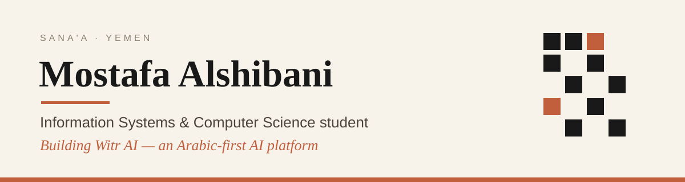

<h3 align="center">Hi 👋 — welcome to my corner of GitHub</h3>

## About me

- 🎓 Studying **Information Systems & Computer Science** at Queen Arwa University
- 🔭 Currently building **Witr AI** — multiple LLM providers behind one clean Arabic-first interface, with persistent memory
- 🛡️ Shipped **RouterGuard** — home-network monitoring with intruder detection, Telegram alerts, and an Arabic RTL dashboard
- 🌱 Deepening my understanding of algorithms, OOP, databases, and AI agents — understanding over memorising
- 💬 Ask me about **Python, LLM APIs, or home-network security**

## Tech stack

  

## GitHub stats

<table align="center">
  <tr>
    <td></td>
    <td></td>
  </tr>
</table>

## Top repositories

<table align="center">
  <tr>
    <td></td>
    <td></td>
  </tr>
</table>

## Reach me

  
  

<i>I build in public, one finished project at a time.</i>

